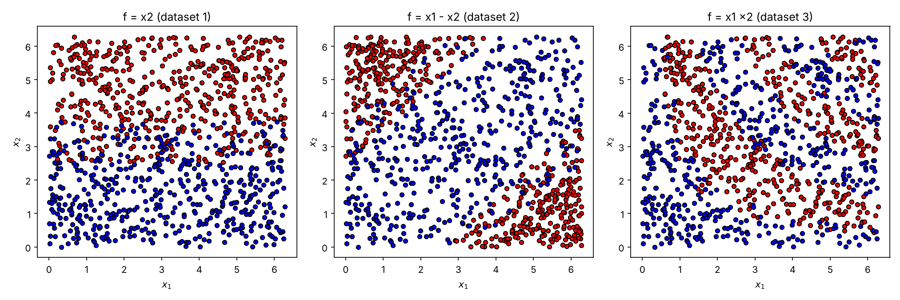
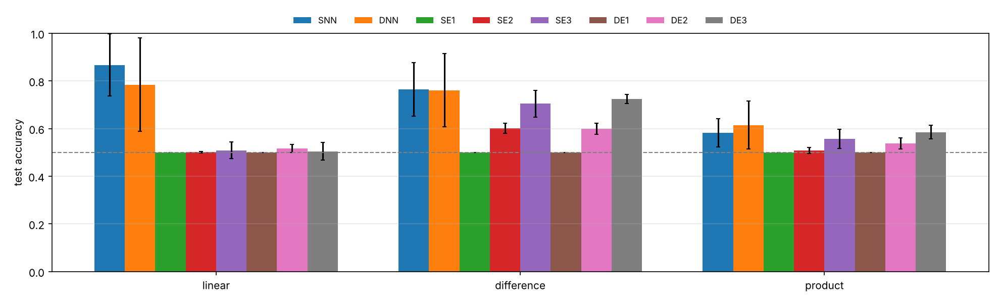

# Quantum–Classical Expressivity

Code of the Applied Quantum Algorithms mini project *Expressivity of the generating set (T.2.E)*.

In this project the ability of a Neural Network and a Parameterized Quantum Circuit (PQC) to learn a synthetic
dataset is tested for different input encodings. Three different datasets are produced by a 2-qubit PQC and
three different encodings are tested for the classifier PQC.



## Results

**From the report (one run per model).** Train/test accuracy × 1000; 'S' and 'D' denote shallow (1 layer) and
deep (5 layers), 'E1,2,3' the encoding of the PQC. Values in parentheses were omitted from the report.

| | SNN | DNN | SE1 | SE2 | SE3 | DE1 | DE2 | DE3 |
|---|---|---|---|---|---|---|---|---|
| Set 1 | 959/917 | (998/992) | 500/500 | 500/500 | 500/500 | | | 610/640 |
| Set 2 | 733/718 | 823/835 | 500/490 | 783/789 | 823/769 | 500/499 | 821/800 | |
| Set 3 | 578/530 | (623/589) | | | 539/544 | | | 633/593 |

Conclusions of the report: the NN outperforms the PQC for the linearly separated dataset, while for the more
complex datasets the models are mostly equivalent, with the PQC having a slight edge. More complex encodings are
generally better and increasing the variational circuit depth does not present much of an advantage.

**This code, averaged over 10 seeds** ([`results/benchmarks.csv`](results/benchmarks.csv)):

| | SNN | DNN | SE1 | SE2 | SE3 | DE1 | DE2 | DE3 |
|---|---|---|---|---|---|---|---|---|
| Set 1 (f = x₂) | 859/868 | 781/785 | 500/500 | 502/501 | 540/509 | 500/500 | 522/517 | 545/505 |
| Set 2 (f = x₁ − x₂) | 783/765 | 775/761 | 500/500 | 599/602 | 705/705 | 500/500 | 602/600 | 723/725 |
| Set 3 (f = x₁x₂) | 584/583 | 620/615 | 500/500 | 512/509 | 569/557 | 500/500 | 538/537 | 590/586 |
| Parameters | 16 | 64 | 3 | 3 | 3 | 15 | 15 | 15 |



What changes with the averages:

- More complex encodings are still better (E3 > E2 > E1) and depth still adds little.
- Encoding 1 is always 0.5: Rz on |0⟩ only adds a global phase, so the PQC does not see the data and assigns the
  same label to the whole dataset (see [docs/theoretical_background.md](docs/theoretical_background.md)).
- Averaged, the NN is better on all 3 datasets, so the slight edge of the PQC in the report does not hold up.
  The PQC uses fewer parameters (3l against 12l + 4) and its results change much less from run to run.
- The numbers differ from the report because single runs vary a lot and because some bugs of the original code
  were fixed (see [docs/methodology.md](docs/methodology.md)).

## How to run it

You need Python 3.10 or newer.

```bash
git clone https://github.com/<your-username>/quantum-classical-expressivity.git
cd quantum-classical-expressivity
python3 -m venv .venv
source .venv/bin/activate          # on Windows: .venv\Scripts\activate
pip install -e ".[dev]"
pytest                             # checks that everything works
```

Run the experiments (all datasets and models, about 1 minute for 10 seeds):

```bash
expressivity-benchmark --seeds 0 1 2 3 4 5 6 7 8 9 --out my_results/benchmarks.csv --figures my_results/figures
```

Use `expressivity-benchmark --help` to see all the options (datasets, models, number of points, seeds, …).

The notebook [`notebooks/original_experiments.ipynb`](notebooks/original_experiments.ipynb) goes through the
experiments step by step, following the original Colab notebook (`pip install -e ".[notebook]"` to get Jupyter).

From Python:

```python
from expressivity import make_dataset, train_pqc, train_mlp

data = make_dataset("difference", n_points=1000, seed=0)
X_train, X_test, y_train, y_test = data.split()

pqc = train_pqc(X_train, y_train, X_test, y_test, encoding="E3", n_layers=1)
nn = train_mlp(X_train, y_train, X_test, y_test, n_layers=1)
print(pqc.test_accuracy, nn.test_accuracy)
```

## Structure

```
src/expressivity/     quantum_circuits.py (PQC), datasets.py (generator), classical_models.py (NN),
                      training.py (training + experiments), evaluation.py (table + figures)
tests/                tests of every module
notebooks/            the project notebook; legacy/ has the original Colab code
docs/                 methodology and theoretical background
results/              benchmarks.csv and figures
```

## Note

The experiments, circuit designs and analysis come from my mini project report. The code was refactored into
this package, and the tests and documentation written, with help from an AI assistant (Claude).

## License

[MIT](LICENSE)
